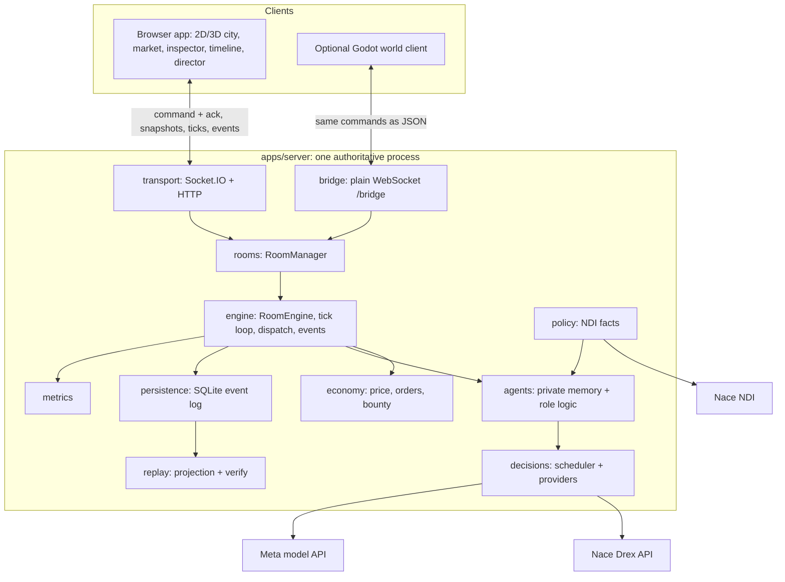
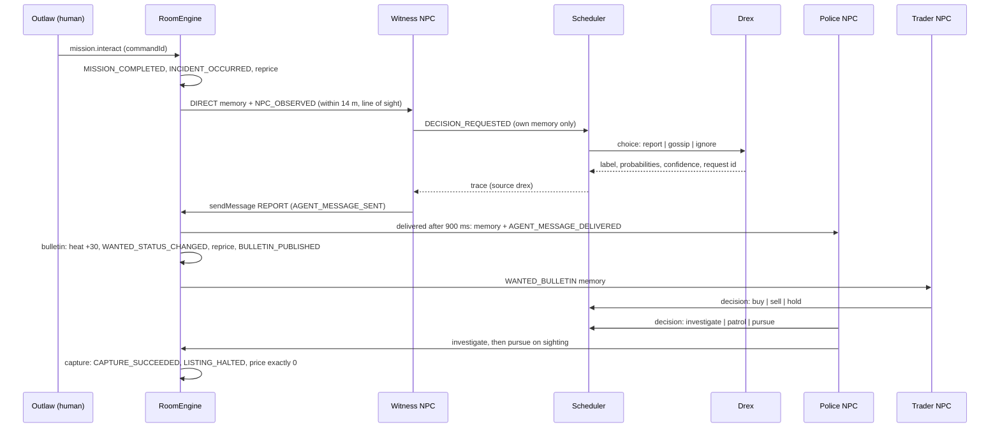

# VICE EXCHANGE: architecture

One Node process owns the world. Browsers and the optional 3D client send intents and render what the server broadcasts. Model providers are called only from the server.

## Components

## One causal chain

## Module map

Ports are defined in `apps/server/src/domain.ts`. Shared public types, events, commands and rules are in `packages/contracts/src`.

| Folder | Responsibility | Port |
|---|---|---|
| `apps/server/src/engine` | `RoomEngine`: room state, 10 Hz tick, synchronous `dispatch`, ordered event emission, movement, missions, perception, wanted state, capture, respawn, reset; `compose.ts` wires the modules; `pathfinding.ts` for NPC walking | implements `WorldPort` |
| `apps/server/src/rooms` | `RoomManager`: rooms, join and reconnect rules, director rights | |
| `apps/server/src/transport` | `app.ts` builds the HTTP app; `socket.ts` validates commands, rate-limits sockets, broadcasts | |
| `apps/server/src/bridge` | Plain WebSocket endpoint `/bridge` for external world clients, same validation and dispatch path | |
| `apps/server/src/agents` | `MemoryStore`, `roles.ts` (decision state and legal actions per role), `Brains.ts` (triggers, stale re-validation, applying actions, trace store) | `MemoryPort`, `BrainsPort` |
| `apps/server/src/decisions` | `providers.ts` (Drex through nace-sdk, Meta through fetch), `scheduler.ts` (queue, concurrency, deadline, budget, circuit breaker, fallback, guardrail, shadow) | `DecisionProvider`, `SchedulerPort` |
| `apps/server/src/economy` | Price formula, wallets, orders, halt, bounty; pure state mutation | `EconomyPort` |
| `apps/server/src/persistence` | SQLite (`node:sqlite`, WAL): events, decisions, experiments | `PersistencePort` |
| `apps/server/src/metrics` | Counts, latency statistics, message edges, shadow comparison, from events and traces only | `MetricsPort` |
| `apps/server/src/replay` | `projectEvents`, `verifyReplay`, CLI | |
| `apps/server/src/policy` | NDI ingestion, cache, citations | `PolicyPort` |
| `apps/server/src/demo` | Seeded roster, scripted outlaw bot, three-mode experiment runner | |
| `apps/web/src` | React app: `state/gameStore.ts`, `net/socketClient.ts`, `components/`, `scene/canvas` (2D), `scene/three` (3D) | |
| `e2e` | Two-browser harness | |
| `integrations/ota-bridge` | Godot-side bridge script and apply script for the optional 3D client | |

## Events

Every authoritative event has `schemaVersion`, `eventId`, `roomId`, `runId`, `serverSequence`, `time` (ISO wall clock), `simTimeMs`, `type`, `actorId`, `causationId`, `correlationId` and `payload` (`packages/contracts/src/events.ts`). Events are ordered per room by `serverSequence`; ids are unique within a room instance and run.

Types: `ROOM_CREATED`, `ROOM_RESET`, `MODE_CHANGED`, `PLAYER_JOINED`, `PLAYER_LEFT`, `WALLET_OPENED`, `CHARACTER_SPAWNED`, `LISTING_OPENED`, `MISSION_SPAWNED`, `MISSION_COMPLETED`, `INCIDENT_OCCURRED`, `NPC_OBSERVED`, `AGENT_MESSAGE_SENT`, `AGENT_MESSAGE_DELIVERED`, `BULLETIN_PUBLISHED`, `DECISION_REQUESTED`, `DECISION_RESOLVED`, `AGENT_ACTION_APPLIED`, `AGENT_ACTION_REJECTED`, `MARKET_PRICE_UPDATED`, `TRADE_EXECUTED`, `TRADE_REJECTED`, `WANTED_STATUS_CHANGED`, `ESCAPE_SUCCEEDED`, `CAPTURE_SUCCEEDED`, `CAPTURE_REJECTED`, `LISTING_HALTED`, `CHARACTER_ARCHIVED`, `CHARACTER_RESPAWNED`, `POLICY_INGESTED`.

## Commands

Clients emit one Socket.IO event, `command`, with an acknowledgement (`packages/contracts/src/commands.ts`): `room.create`, `room.join`, `player.move` (direction intent only), `player.pose` (position report from an external world client, checked for bounds and speed), `mission.interact`, `market.buy`, `market.sell`, `capture.attempt`, `character.respawn`, `demo.reset`, `demo.incident`, `demo.setMode`, `demo.runExperiment`. Every command that changes money, capture, missions or life state carries a `commandId`; a repeated `commandId` from the same player returns the original acknowledgement with `duplicate: true`.

Server pushes: `room.snapshot`, `world.tick` (10 Hz), `event`, `agent.update`, `listing.update`, `character.update`, `mission.update`, `wallet.update` (owner only), `provider.status`, `metrics.update`, `experiment.update`.

HTTP: `/health`, `/api/rooms/:code/snapshot`, `/api/rooms/:code/events`, `/api/rooms/:code/agents/:id/trace`, `/api/rooms/:code/replay/verify`, `/api/experiments`, `/api/policy`, `/api/policy/xray.svg`.

## State machines

- Character: `ACTIVE -> WANTED -> CAPTURED -> ARCHIVED`; `WANTED -> ACTIVE` on escape. Capture is terminal; respawn creates a new character and ticker.
- Listing: `ACTIVE -> HALTED_CAPTURED`, one way, price 0.
- Decision: `REQUESTED -> RESOLVED -> APPLIED`, or `REQUESTED -> TIMEOUT / ERROR -> FALLBACK_APPLIED`; a stale or illegal result goes to `REJECTED` and stays inspectable.

## Persistence and replay

Each event is written to SQLite before it is broadcast, keyed by room instance, run and sequence. Decisions and experiments are stored as well. `verifyReplay` folds the stored events with no model calls and compares wallets, listings and character outcomes with live state; the server exposes it at `/api/rooms/:code/replay/verify`, and `npm run replay` prints a run's projection. Room state itself is in memory: a restart starts a fresh seeded room and keeps the logs.

## Security model

- Provider keys are read in `apps/server/src/config.ts` and used only in `apps/server/src/decisions/providers.ts` and `apps/server/src/policy`. `/health` returns booleans only.
- Every client command is parsed with `clientCommandSchema` (zod). Clients never send prices, wallet totals or decision outputs. `player.move` carries a direction only.
- Sockets are rate-limited. Demo commands require the director flag (`RoomEngine.dispatch`), which comes from creating the room, being the first browser in the default room, or presenting the director secret (`RoomManager`). A room code alone does not grant it.
- All credits are integers held in server state.

## How the honesty rules are enforced

- `apps/server/src/decisions/scheduler.ts` is the only place a trace gets its `decisionSource`. `drex` or `meta` is set only in the success branch of a real provider call. Every failure path goes through `fallback()`, which sets `fallback`, records the error type and leaves confidence and probabilities null. Scripted mode never calls a provider.
- A Drex answer whose confidence is under `RULES.decisions.lowConfidenceThreshold` is labeled `drex_low_confidence_guardrail` and keeps the provider's real choice and numbers.
- A provider answer that arrives after the deadline is discarded. A label that was not offered is rejected as `invalid_response`.
- `apps/server/src/agents/roles.ts` builds the decision state from `MemoryPort.recall(agentId)` only; `brains.test.ts` and the AT-02 acceptance test check that an NPC that was told nothing has no trace of the incident in its state.
- `apps/web/src/lib/format.ts` maps each source to its own badge, and the inspector shows probabilities only when the trace has them.
- `apps/server/src/policy` reports facts as NDI-derived only when a real NDI job produced them; otherwise its view is null.
