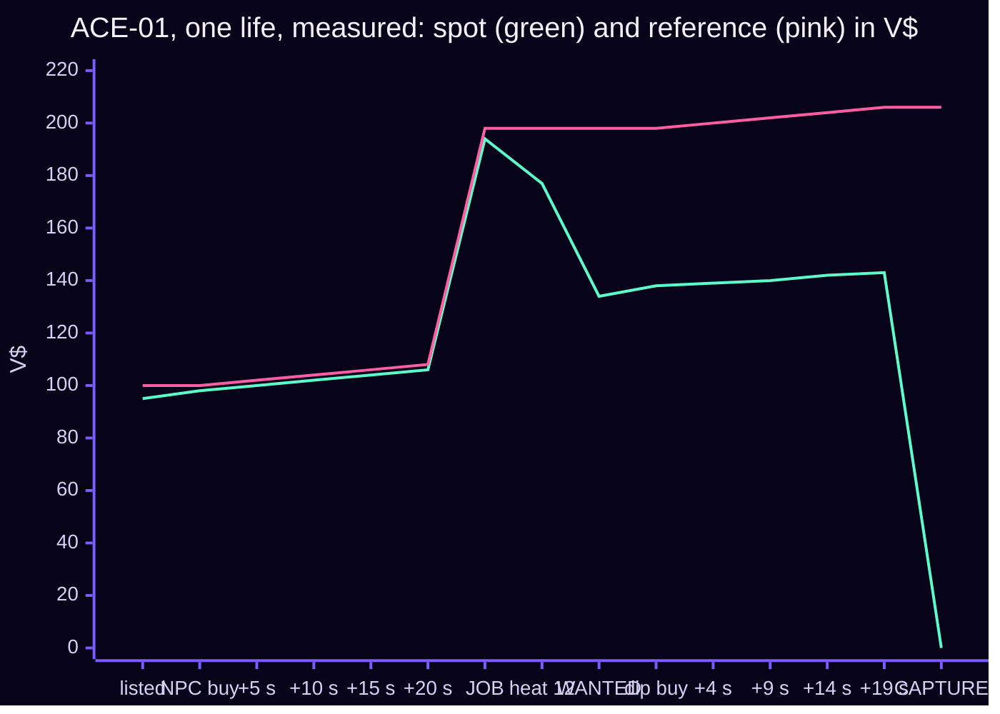

# VICE EXCHANGE: five-minute live demo script

This script follows the seven beats of section 9 of the product spec ([`docs/spec/PRD.md`](spec/PRD.md)) in the
same order and fits in five minutes. Rehearse it twice before going on stage: the walking routes are the only
part that needs practice.

How this script was checked. On 2026-11-14 at 13:15 PST, beats 2 to 6 up to the respawn (join, walk, job, hide,
inspect, capture, respawn, director tab, 3D view) were driven through two headless Chrome pages with real key
and mouse events against a private server with live Drex. The same choreography was also run at 13:09 through
the socket API. The two-hop rumor chain in beat 6 and the experiment in beat 7 were verified through the socket
API at 12:48 and 12:49, before the last pacing changes. A human has not yet performed the whole script in one
take. Every time quoted below was measured once or a few times on one machine. Treat them as "about".

## The one thing to know about pacing

After the witness's report reaches the police, the outlaw is WANTED. From that moment:

| If the outlaw... | then... | Measured |
|---|---|---|
| stands still at the dock | the police arrive after their 10 s dispatch delay and capture | 24.8 s after the job in one run (25.6 to 28.4 s in three other runs by the build lead) |
| hides out of police sight | it stays WANTED, then escapes when heat decays | escape 59.8 s after the job in one run |
| is reached by a hunter while WANTED | the hunter's E captures and the hunter is paid the bounty | done at 3.0 s, 22.9 s and 42.5 s after the job in three runs |

So the capture has to happen within about 50 seconds of the job. The spec's table put it at 2:45. This script
does the capture at about 1:50 and gives the time saved to the two beats that need it: provenance and the
measured comparison.

| Beat | Spec section 9 | Spec time | This script |
|---|---|---|---|
| 1 | Explain the city, the tickers, the NPC roles | 0:00 to 0:35 | 0:00 to 0:35 |
| 2 | Second player, complete a mission | 0:35 to 1:15 | 0:35 to 1:10 |
| 3 | Witness decides; the message reaches police and traders | 1:15 to 2:00 | 1:10 to 1:30 |
| 4 | Trader position, police plan, market chart | 2:00 to 2:45 | 1:30 to 1:45 |
| 5 | Capture; the stock goes to V$0 | 2:45 to 3:30 | 1:45 to 2:15 |
| 6 | Respawn; old ticker and decision provenance | 3:30 to 4:15 | 2:15 to 3:25 |
| 7 | Scripted versus Meta versus Drex numbers; NDI passage | 4:15 to 5:00 | 3:25 to 5:00 |

## Before the demo

### Once, well ahead of time

1. `.env` contains `NACE_API_KEY`, and `META_API_KEY` if you want the Meta lane and the shadow comparison.
2. Load the police policy facts once so they come from the cache on stage:

   ```bash
   npm run ndi:ingest
   ```

   It prints the document, the NDI job ids and nine facts. With a cache it makes no NDI call.
3. Prove both providers answer from this machine (one real call each, a few cents at most):

   ```bash
   cd apps/server && npx tsx src/decisions/liveSmoke.ts
   ```

   The Drex line must end with `DREX: LIVE` and show a `providerRequestId` starting with `req_`.

### Ten minutes before

1. Start the app on the presenting machine and leave the terminal visible to you, not to the audience:

   ```bash
   npm run dev
   ```

   Wait for both lines:

   ```text
   [vice-exchange] server listening on http://0.0.0.0:3001 (drexConfigured=true, metaConfigured=true, room=VICE-42)
   [policy] 9 NDI policy facts ready from "SFPD Department General Order 5.25 ...
   ```

2. Check the server:

   ```bash
   curl -s http://localhost:5173/health
   ```

   Expect `"badge":"DREX: LIVE"`, `"mode":"drex"`, `"policyLoaded":true`.

3. Open **window A** first, on the presenting machine itself, with a `localhost` address. The first browser on
   the server's own machine to join `VICE-42` becomes the demo director. A browser on another laptop never does.

   ```text
   http://localhost:5173/?nick=Ace&role=OUTLAW&room=VICE-42&auto=1
   ```

   The header must read `Ace · OUTLAW · DIRECTOR`.

4. Open **window B**:

   ```text
   http://localhost:5173/?nick=Hawk&role=HUNTER&room=VICE-42&auto=1
   ```

5. Arrange the windows side by side: A on the left, B on the right. On a 1920 x 1080 display give each 960 pixels.
   On a smaller screen put B on a second display or a second laptop (use the network address Vite printed, for
   example `http://192.168.0.126:5173/?nick=Hawk&role=HUNTER&room=VICE-42&auto=1`). Browser zoom 100 percent.
   The layout was checked at 1440 x 900 and 960 x 1080.

6. Check the **provider badge** in the header of both windows: a green `DREX: LIVE`. Also check that the tape under
   the header already shows a `SWARM` item such as "8 agents · 2 decisions by DREX 2": those are the two traders
   reacting to the new listing with real calls.

7. In window A open the tab `DEMO DIRECTOR · METRICS` and press **Seeded reset**. Do this last, right before
   you start: a character's value grows by V$2 every 5 seconds it survives, so an old room shows a higher price.
   Then go back to `EVENT TIMELINE`. Both windows now show a fresh `ACE-01` near V$95 to V$98.

8. Click once on the city in window A so the keyboard drives Ace.

9. The app opens in the 3D city. If the frame rate is poor, press `2D` in the header of that window; everything
   in this script works in both views. The 3D view lowers its own quality after 5 seconds under 20 frames per second.

### Controls

| Key | Outlaw | Hunter |
|---|---|---|
| W A S D or arrows | Move (W is north, away from the water) | Move |
| E | Do the job at the marker | Capture a WANTED outlaw within 2.5 m |
| R | Respawn after capture | not used |

Keys go to the window that has focus. Click a window before you use its keys. Typing in a text field does not move the avatar.

### The walking routes

Speed is 9 metres a second. W is north, S is south (towards the water), A is west, D is east, in both the 2D
and the 3D view. Rehearse these until they are automatic. Coordinates are in metres on the 120 x 80 map.

| # | Route | Keys | Measured |
|---|---|---|---|
| 1 | Hawk, spawn (92, 28) to the dock | Hold A west along The Strip to the next crossing (x 62). Hold S down that road to the road above the marina (z 54). Hold A until Hawk is just right of the green marker "Marked package at the dock" (x 49). A touch of S. | 8.0 to 8.7 s |
| 2 | Ace, spawn (60, 68) to the job (47, 60) | Hold A until Ace is level with the marker, then W into the ring. | 2.3 s |
| 3 | Ace, job to the hiding place (18, 71) | Hold S to the boardwalk at the water's edge, then hold A until Ace is below the Dockside Warehouse, the last building to the west. | 4.3 s |
| 4 | Hawk, dock to the hiding place | The same two legs: S to the boardwalk, then A until Hawk stands next to Ace. | 4.5 s |
| 5 | Ace's second life, spawn (34, 68) to the plaza job (52, 48) | Hold W up to the road above the marina (z 56). Hold D until Ace is level with the marker "Drop bag in Neon Plaza". W into the ring. | 4.2 s |

The hiding place works because both officers walk to the last known location, the dock, from the north, and the
south-west boardwalk is more than 14 metres from the dock and from their routes. In three runs no officer saw
the outlaw there.

## The script

Clock times are targets. "Say" is one sentence; add your own words around it.

### Beat 1, 0:00 to 0:35. The city, the tickers, the roles

| | |
|---|---|
| **Do** | Nothing yet. Point at window A: the city, the tape under the header, the market card `ACE-01`, the eight chips under AGENT INTELLIGENCE, the small swarm graph below them, and the line "V$ are fictional, nonredeemable game credits". |
| **Audience sees** | A neon city called Coral Bay with Ace in it. Header: `ROOM VICE-42`, `2 players`, `8 agents`, `DREX: LIVE`. Market: `ACE-01` near V$98 with bid, ask, reference value and "bounty". Two cards under WATCH THE SWARM THINK from the traders' first decisions, each stamped `DREX LIVE` with a request id. |
| **Say** | "Every outlaw in this city is a stock, eight NPCs each decide for themselves with a real Drex call, and if you get caught your stock goes to exactly zero; all the credits are fictional." |
| **Proves** | The concept and the incentives: two witnesses, two informants, two traders, two police officers, and a market that prices a character's survival. |

### Beat 2, 0:35 to 1:10. A second player, and a job

| | |
|---|---|
| **Do** | 1. Click window B. Walk Hawk to the dock (route 1) and stop beside the green marker. 2. Click window A. Walk Ace into the marker ring (route 2). 3. Press **E**. 4. At once run Ace to the hiding place (route 3) and let go of the keys. |
| **Audience sees** | Hawk moving in both windows at the same time. When Ace presses E: a toast "Job done. Notoriety up — and someone may have seen you.", and the price jumps then dips. In the rehearsal it went V$106 -> V$194 (mission) -> V$177 (heat). About 1.4 seconds later: `WANTED 2/5` in Ace's status bar, the price drops again (V$177 -> V$134), and the tape shows a `REPORT` item and a `BULLETIN` item. |
| **Say** | "Two real players on one authoritative server; that job just raised my reference value, and one witness saw me do it." |
| **Proves** | Synchronized multiplayer. A mission changes the reference value by a fixed formula. The price can fall before any capture because risk went up. |

### Beat 3, 1:10 to 1:30. The witness decided, and only she knew

| | |
|---|---|
| **Do** | In window A click the chip **Vega** under AGENT INTELLIGENCE. Open the line "Exactly what this NPC told the model" for a second. Then click the chip **Okoye**. |
| **Audience sees** | Marisol Vega's card: `DREX · live`, `-> report`, three bars (in the rehearsal: report 97.9%, ignore 1.1%, gossip 1.1%), `model drex-max-v1.1`, `confidence 0.968`, `round trip 475 ms`, `model eval 165 ms`, a request id `req_...`, tokens, and a line "Shadow meta (muse-ember-1.0): report in 763 ms · agrees · not applied". Under KNOWS: an INCIDENT entry "saw it first-hand · hop 0 · belief 95%". The opened line shows the JSON that was sent: her role, persona, goal, her own memories and her contact, nothing else. Lena Okoye, 16 metres from the job and outside the 14 metre perception radius, has no INCIDENT entry. Her only entry is the WANTED BULLETIN, marked "public bulletin · from Sgt. Imani Duarte · hop 1 · belief 90%". |
| **Say** | "This is a real Drex call built only from what Marisol saw herself, with its probabilities, latency and request id; the informant next door never saw the job and knows only what the police published a second later, and her memory says so." |
| **Proves** | Real Drex decisions with probabilities, confidence, latency and a provider request id. Private memory: each fact sits with the NPC that observed it, and every other copy names how it arrived. |

### Beat 4, 1:30 to 1:45. Traders and police react to the same news differently

| | |
|---|---|
| **Do** | Point at the cards under WATCH THE SWARM THINK, then at the market card and the TRADE FEED. |
| **Audience sees** | Four decisions that followed the wanted bulletin: Priya Castellan `BUY` (she bought the dip at V$134 in the rehearsal), Rook Halvorsen `HOLD`, Sgt. Imani Duarte and Ofc. Cole Renner `INVESTIGATE` with the action line "dispatch in 10 s, then on foot to the last known location". The chart shows the spike, the two drops and the small rise from the NPC's order. TRADE FEED: "BUY 1 ACE-01 @ V$134 · Priya Castellan (NPC)". |
| **Say** | "The report became a public bulletin; the momentum trader bought the dip, the cautious one held, and both officers chose to investigate, each from its own memory and each with its own Drex call." |
| **Proves** | A multi-agent causal chain acting on one shared market. NPC orders go through the same settlement as a human order. |

### Beat 5, 1:45 to 2:15. Capture: exactly V$0

| | |
|---|---|
| **Do** | Click window B. Walk Hawk to Ace (route 4). Press **E**. Let the full-screen sequence play (about 5 seconds; a click or Esc ends it early). |
| **Audience sees** | Both windows are taken over by the crash sequence: "CAPTURED · ACE · LISTING HALTED", the ticker in huge letters, the spot price counting down to V$0, the price line falling off a cliff, and three facts: "CAPTURED BY Hawk · HUMAN HUNTER", "BOUNTY PAID V$103 credited to the captor", "SURVIVED 44s". Afterwards the market card reads `ACE-01 V$0 HALTED` and "Captured · last traded V$143 -> V$0 · history kept, trading closed". Hawk's wallet reads V$2,103. Ace's status bar reads "CAPTURED — press R to respawn". The numbers are from the rehearsal; yours will differ by a few credits. |
| **Say** | "Captured: one atomic step set the ticker to exactly zero, closed trading and paid the hunter half the reference value once, which is why waiting longer pays more." |
| **Proves** | The capture is atomic and deterministic. The listing is halted at exactly V$0. The bounty is paid once and grows with survival time. |

If the police get there first, the same sequence plays with "CAPTURED BY Sgt. Imani Duarte" and no bounty,
because an NPC captor is not paid. Say that instead; the rule shown is the same.

### Beat 6, 2:15 to 3:25. A new life, an old record, and where each decision came from

| | |
|---|---|
| **Do** | 1. Click window A and press **R**. 2. Point at the two market cards. 3. In `EVENT TIMELINE` untick "follow live", scroll up and click the row `MISSION COMPLETED`. 4. Click the tab `SWARM GRAPH`. 5. Walk the new Ace to the marker "Drop bag in Neon Plaza" (route 5). Look at the map: wait until no police officer is on the street between Neon Plaza and Mirage Mall. Press **E**. |
| **Audience sees** | 1. A toast "New life, new ticker. Your old record stays on the board." A new card `ACE-02` at V$95 above the old card `ACE-01 V$0 HALTED` with its whole chart. 3. The rows of that story light up and the bar reads "Clear chain (21 linked)" or a similar count: job, incident, Marisol saw it, Drex chose report, message, bulletin, decisions, trades, capture, halt. 4. The swarm graph: lanes for witnesses, informants, traders and police, an arrow from Vega to Duarte labelled REPORT, the PUBLIC BULLETIN node, a stamp on every NPC that decided, and a legend of who decided (DREX, META, SCRIPTED, FALLBACK, GUARDRAIL). 5. Otis Brandt, the plaza vendor who distrusts the police, is 4 metres from the job. In the verification runs he chose `gossip` (confidence 0.94 and 0.87), Dex Marlowe chose `relay`, and Rook Halvorsen then decided on a rumor that had travelled two hops. The graph counter then reads `2 MAX HOPS`. |
| **Say** | "New life, new ticker, and the old one stays on the record; every step links to its cause, and this second rumor reached the trader through two recorded messages, each one a separate Drex decision." |
| **Proves** | Respawn with history. Causation is recorded event by event. A multi-hop message chain: witness -> informant -> trader, with hop counts and falling belief (95%, 70%, 50%). |

Step 5 depends on the model and on where the police are. Steps 1 to 4 give the officers the half minute they
need to walk back to their beats; in one run where the second job was done five seconds after the capture, an
officer was still passing the plaza, saw the job, and captured the new character within two seconds. If Otis
chooses `report`, or an officer sees the job directly, a bulletin follows instead of gossip: that is the one-hop
chain again, and the second Ace becomes WANTED. Say what happened. Do not promise the audience a particular
choice in advance. In the one run where the chain was completed end to end (12:49 PST), it was started with the
director's **Trigger incident** button while the outlaw stood next to Otis, which works the same way and adds no heat.

### Beat 7, 3:25 to 5:00. Measured numbers, and the document behind the police

| | |
|---|---|
| **Do** | 1. Click the tab `DEMO DIRECTOR · METRICS` and press **Run scripted vs Meta vs Drex**. The panel grows by itself. 2. While it runs (up to 45 seconds; rows refresh every 2 seconds), read out LIVE METRICS. 3. Click the chip **Duarte** and scroll her card to the lines that start with a page icon. 4. When the experiment says DONE, read the three rows. 5. Press "smaller" to give the city its space back. |
| **Audience sees** | LIVE METRICS, "measured in this run, nothing estimated": decisions by source (for example `drex 16`), by role, by action, `DREX ROUND TRIP p50 ... p95 ...`, messages sent and the longest rumor chain, trades by NPC and human, and "WHO TALKS TO WHOM". A line `POLICY DOC SFPD Department General Order 5.25 "Foot Pursuits" ... parsed by NDI (job 8dc24341-...) · 9 facts`. Duarte's card: her Drex decision plus quotes such as p.2 "An officer may initiate a foot pursuit when they reasonably believe the person has committed an act that would justify a detention, custody, or arrest", each tagged with the field name and the NDI job id. The table BASELINE COMPARISON: one row each for SCRIPTED, META and DREX with decisions, real model calls, fallbacks, p50 and p95 latency, messages, rumor hops, NPC trades, reported, captured, time to capture, peak and final price, and the caveat sentence underneath. |
| **Say** | "Same seed and the same scripted outlaw, three ways: fixed rules with zero model calls, a Meta LLM, and Drex; these latencies and outcomes were measured just now, one run each, which is a demonstration and not a benchmark; and the police also read nine rules that NDI extracted from a real police order, quoted with page numbers." |
| **Proves** | The model's contribution is measured against two baselines on the same scenario, with the limits stated. NDI is used on a real-world document and the citation travels into the decision. |

For reference, one experiment run during verification (seed 42, 12:48 PST, before the police dispatch delay was
added) gave: scripted 9 decisions, 0 model calls; Meta 9 calls, p50 812 ms, p95 1575 ms, 1 NPC trade; Drex 9
calls, p50 291 ms, p95 536 ms, 2 NPC trades. Read your own numbers from the screen, not these.

### What the chart looks like

The price path of `ACE-01` in the rehearsal, from listing to capture (15 recorded points, 44 seconds).
Green is the spot price, pink is the reference value.



## A shorter path, if you want less to go wrong

Skip the hiding place. Park Hawk beside the dock marker in beat 2, do the job, and stay where you are. Do beats
3 and 4 quickly, then press E in window B before about 20 seconds have passed. If you are late, the police make
the capture at about 25 seconds and the hunter is not paid. Everything is still on the timeline afterwards, so
beats 3 and 4 can also be told after the capture by clicking the same chips.

## When things go wrong

**Drex is slow or down.** A decision that gets no answer within 3 seconds, or an error, becomes a fallback.
What changes on screen:

- The header badge turns from a green `DREX: LIVE` to an amber `DREX: FALLBACK`. It returns to `LIVE` after the next successful call.
- Timeline rows read, for example, `Marisol Vega chose "ignore" [FALLBACK rule · timeout]`.
- The inspector card is labelled `FALLBACK rule`, shows the error type, and prints "No model was called for this decision (drex was attempted)". There are no probability bars and no confidence.
- After three failures in a row, or one authentication or credit error, calls stop for 15 seconds (`circuit_open`).

The room keeps running: movement, trading, heat, capture and respawn are plain code. The fallback actions are
the safe ones (witness `ignore`, informant `withhold`, trader `hold`, police `patrol`), so the story stops moving
by itself. Say exactly this: "Drex is not answering right now, so these NPCs are on labeled fallback rules."
Never describe a fallback as a Drex result.

**Switch to scripted mode** when Drex stays down. In window A: `DEMO DIRECTOR · METRICS`, then the button
`SCRIPTED` in the three-way switch. The badge reads `SCRIPTED`, the header reads `mode SCRIPTED`, and new
decisions are labelled `SCRIPTED rule`. The scripted rules are fixed: a witness always reports, an informant
always relays, a trader always holds, an officer pursues when it has a fresh sighting and investigates otherwise.
The whole script works in this mode, with one exception: there is no gossip chain, because a scripted witness
never gossips. Say: "This run uses fixed rules; no model is being called." The third button, `META LLM`, uses
Meta's model instead; the badge reads `META: LIVE`, cards read `META LLM · live` and show no probabilities,
because that API does not return any.

**Other things that can happen**

| What you see | Why | What to do |
|---|---|---|
| The header has no `DIRECTOR` after your name | Window A was not the first local browser, or you opened it through a network address | Press Leave, open the "Demo director secret" line on the join form, enter the secret, join. The secret is `DEMO_DIRECTOR_SECRET` in `.env`; if that is empty the server printed one for this run in its terminal. |
| "Experiments need the director secret or the server's own machine" | The experiment spends real provider budget, so a director who is not on the server's machine also needs the secret | Rejoin with the secret, or run it from the presenting machine. |
| Hawk presses E and gets "Capture rejected: target not wanted" | Ace escaped: heat decayed below 30 about a minute after the job | Say that this is the escape rule. Do the next job with Ace, or let the director press **Trigger incident** while Ace stands within 14 metres of an officer: the officer sees it, publishes a bulletin and Ace is WANTED again. |
| "Capture rejected: out of range" or "line of sight blocked" | Hawk is more than 2.5 m away, or a building is between them | Move closer and press E again after 1.5 seconds. |
| The witness chose `ignore` or `gossip` at the dock | It is the model's decision | With `gossip` you have the two-hop chain early: show it. With `ignore` nothing follows: press **Trigger incident** near an officer, or do the next job. |
| The police capture Ace before Hawk does | Ace stayed in their sight | Carry on with beat 5; mention that an NPC captor earns no bounty. |
| The 3D city stutters or looks wrong | The graphics hardware | Press `2D` in the header. If the 3D renderer fails outright, the app shows the 2D map by itself. |
| An amber `DISCONNECTED` badge in the header | The socket dropped | Wait; the page reconnects and re-attaches to the same character with its session token. Reloading the tab does the same. |
| The room is in a state you do not want | Rehearsal leftovers | `DEMO DIRECTOR · METRICS`, **Seeded reset**. Connected players get fresh characters; `ACE-01` starts again. |
| The experiment table is cut off on the right | The table is wider than the panel at 1440 pixels | Scroll the panel sideways, or zoom the browser out one step. |

There is no pre-recorded fallback video in this repository. If you record one, label it as a recording when you
show it, and do not present anything in it as a live Drex result.

## What each beat gives a Swarm Intelligence judge

| Judge's question | Beat | Evidence on screen |
|---|---|---|
| Do the agents hold private state? | 3, 6 | One NPC has the memory, its neighbour does not; every memory names its source and hop count. |
| Is Drex really making each decision? | 3, 4 | `DREX · live`, per-label probabilities, confidence, round-trip and model time, provider request id on every card. |
| Do the agents communicate, or does the server just tell everyone? | 3, 6 | REPORT, GOSSIP and RELAY messages as events with a sender, a recipient and a hop count; the swarm graph draws them. |
| Do they compete or coordinate? | 4 | Two traders read the same bulletin and take opposite sides; two officers converge on one location. |
| Does it change anything real? | 4, 5 | NPC orders move the shared price; a police decision ends in a capture; the ticker goes to exactly V$0. |
| Is state correct under pressure? | 5, 6 | One capture, one bounty, halted listing, new ticker, old history; `/api/rooms/VICE-42/replay/verify` returns `ok: true` if anyone asks. |
| What does the model add? | 7 | The same scenario under scripted rules, a Meta LLM and Drex, with measured latency and outcomes and an explicit caveat. |
| Real-world documents? | 7 | Nine quoted rules from a published police order, extracted by NDI, cited with page numbers inside the decision. |
